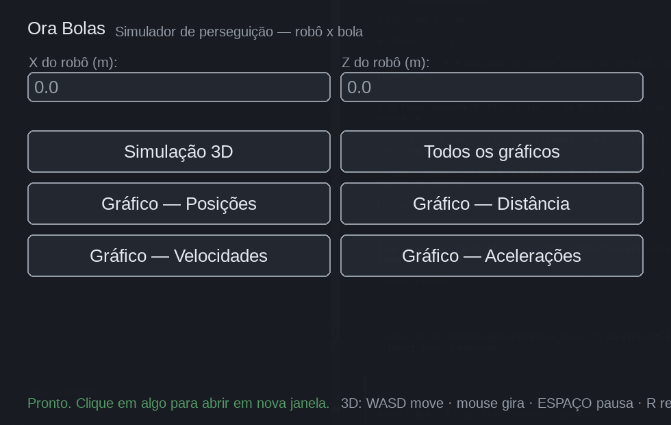
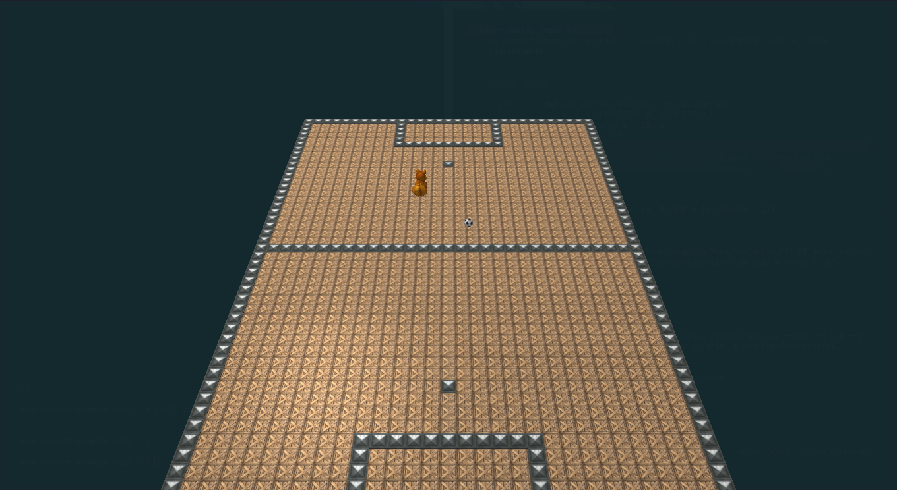
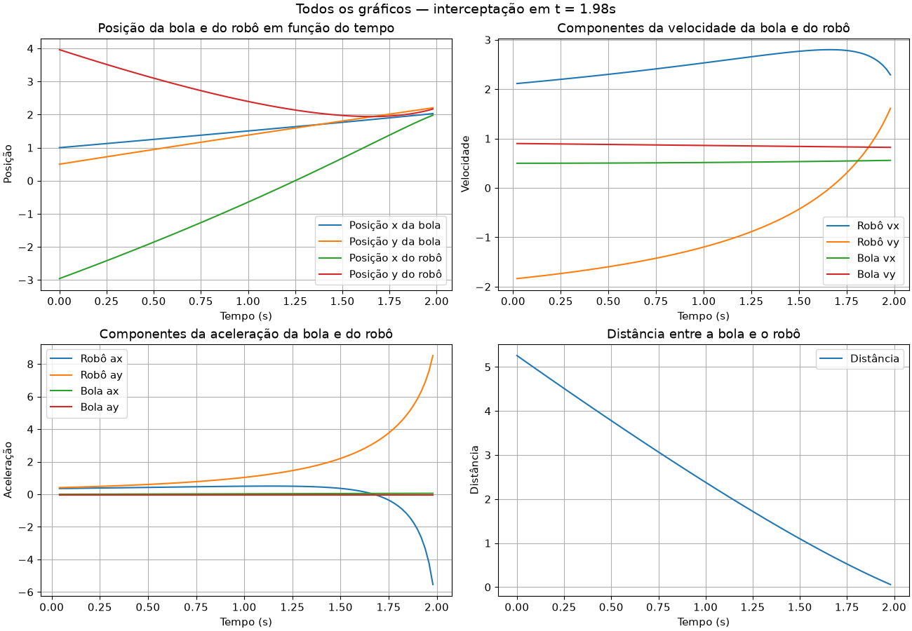

# Ora Bolas
## Projeto FEI Ora Bolas

O projeto Ora Bolas busca resolver o desafio do futebol de robôs: o robô deve
perseguir a bola e chutá-la para dentro do gol. Este repositório traz:

* **Simulação 3D** (OpenGL) do robô perseguindo a bola em um campo;
* **Gráficos** de posição, componentes de velocidade e aceleração da bola e do
  robô, e a distância entre eles;
* **Launcher gráfico** para abrir cada um desses itens (funciona no Linux e
  Windows).

## Screenshots

| Launcher | Simulação 3D |
|---|---|
|  |  |
| **Todos os gráficos (uma janela só)** — posição, velocidade, aceleração e distância | |
|  | |


## Instalação

Requer Python 3.10+. Instale as dependências:

```
pip install -r requirements.txt
```

## Como usar (Linux e Windows)

Abra o launcher (janela com botões):

```
python3 main.py          # Linux
python main.py --gui     # alternativo
```

Pela interface você define a posição inicial (X e Z, em metros) do robô e abre,
clicando no botão correspondente:

* **Simulação 3D** — janela OpenGL interativa
* **Todos os gráficos** — 4 gráficos em uma janela só
* **Gráfico — Posições / Velocidades / Acelerações / Distância** — cada um separado

### Linha de comando (sem launcher)

```
python3 main.py --sim --x 0.0 --z 0.0                # simulação 3D
python3 main.py --graph all     --x 0.0 --z 0.0      # todos os gráficos
python3 main.py --graph positions --x 0.0 --z 0.0    # um gráfico específico
#            (positions | velocity | acceleration | distance)
```

## Controles da simulação 3D

| Tecla      | Ação                          |
|------------|-------------------------------|
| W A S D    | mover a câmera                |
| Q / E      | subir / descer                |
| Mouse      | girar a câmera                |
| ESPAÇO     | pausar / retomar a animação   |
| R          | reiniciar a cena              |
| ESC        | sair                          |

## Melhorias nesta versão

* Sem `input()` bloqueante: a posição inicial é passada pela GUI ou CLI;
* `pywavefront` substituído por um loader de OBJ próprio (`obj_loader.py`),
  compatível com Python 3.14 — o parse de modelos grandes é cacheado em disco;
* Campo (chão + linhas) consolidado em **2 draw calls estáticos** no lugar de
  ~3.000 objetos individuais — carregamento instantâneo e quadros estáveis;
* Interpolação da trajetória pré-computada com `CubicSpline` (o frame só
  indexa os dados prontos);
* Texturas carregadas com Pillow (sem depender do display do SDL);
* Cinemática vetorizada com numpy nos gráficos e a velocidade do robô
  limitada corretamente pela norma (2.8 m/s);
* Backend de gráficos Qt (PyQt6), já que o Tk não existe por padrão em várias
  distros Linux;
* caminhos absolutos à raiz do projeto (roda de qualquer diretório);
* cleanup correto dos recursos de GPU ao fechar a janela.
